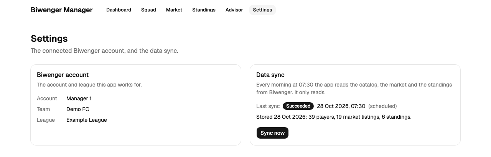
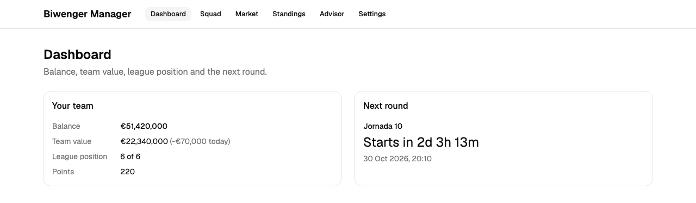
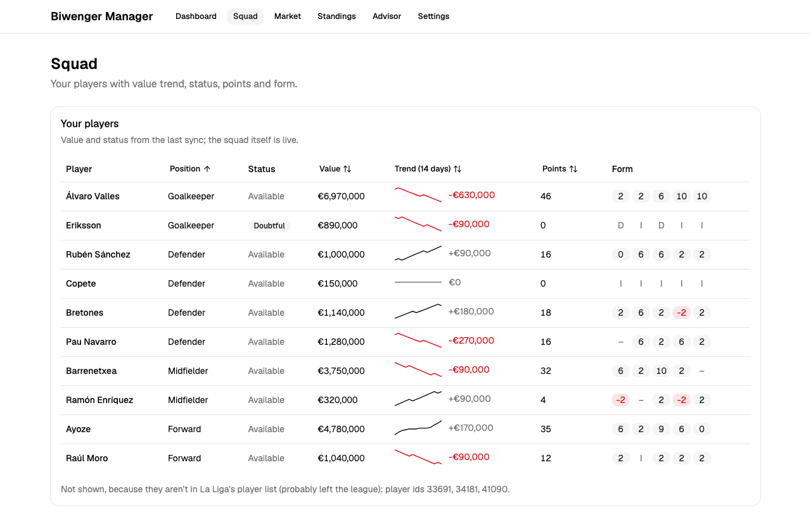
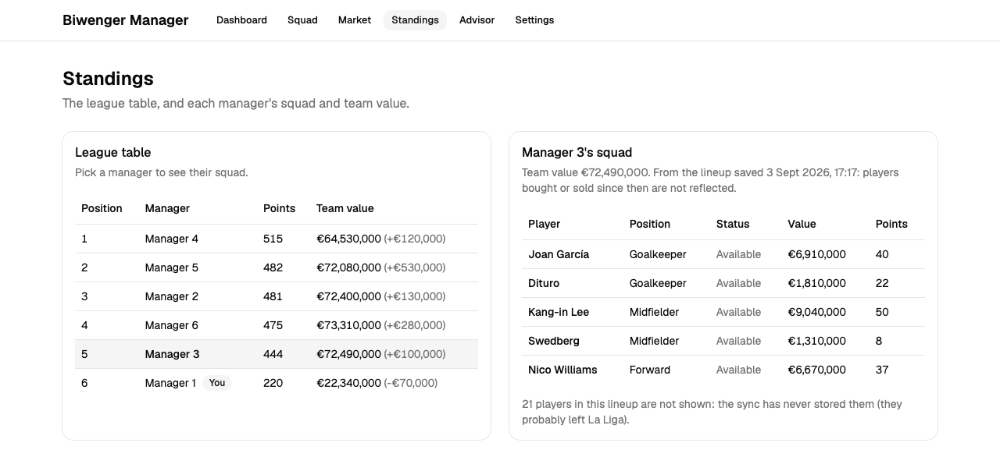
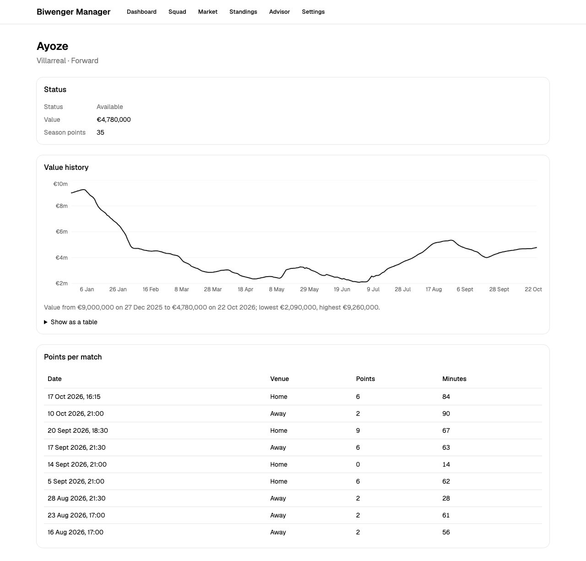
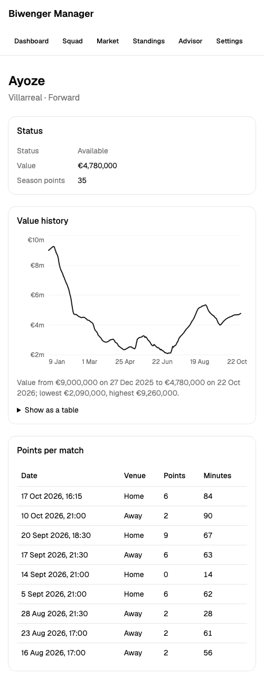
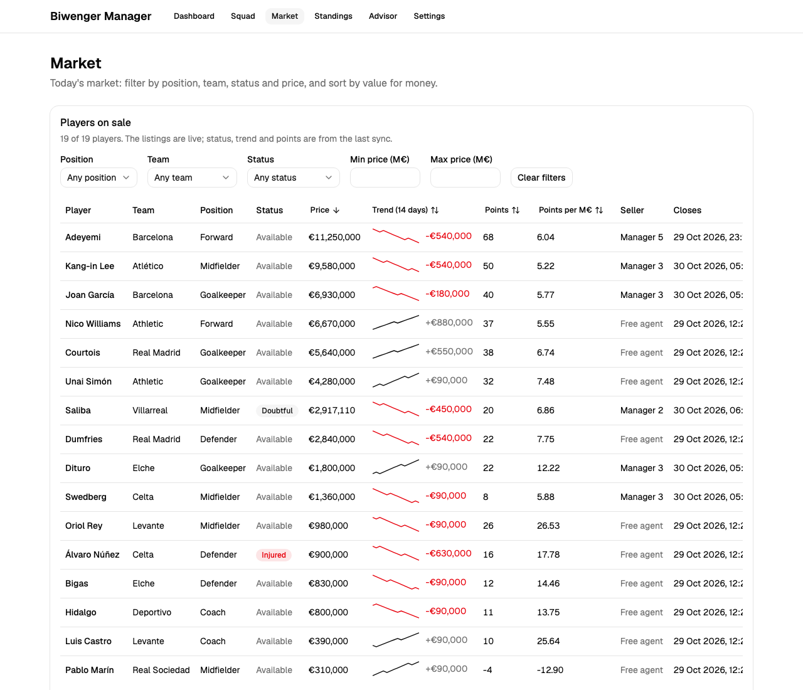

# 05 — Building UI with AI

Phase 4 turns the stored data into pages you can use:

- **Settings:** the connected account and the data sync
- **Dashboard:** balance, team value, league position and the next round
- **Squad:** your players
- **Market:** with filters
- **Standings:** with each rival's squad
- **Player:** one page per player, with a value chart

All of it is read-only: nothing here writes to Biwenger. Claude Code wrote every page, backend endpoint included. This chapter is about the loop that produced them: ask, build, test, review, **look**, run. It is also about what each step caught that the others missed.

Issues: [#27](https://github.com/DavidMS/biwenger-manager/issues/27) settings, [#28](https://github.com/DavidMS/biwenger-manager/issues/28) dashboard, [#29](https://github.com/DavidMS/biwenger-manager/issues/29) squad, [#86](https://github.com/DavidMS/biwenger-manager/issues/86) shared error state (raised by a review), [#30](https://github.com/DavidMS/biwenger-manager/issues/30) market, [#31](https://github.com/DavidMS/biwenger-manager/issues/31) standings, [#32](https://github.com/DavidMS/biwenger-manager/issues/32) player detail and [#33](https://github.com/DavidMS/biwenger-manager/issues/33) this chapter.

## Goal

A read-only UI sounds like the easy phase. The data exists, so the job is to show it. Two things made it harder than it looks:

- **Every page has to decide where its data comes from.** Some data changes during the day (your balance, who you own, what's on the market) and some once a day (values, form). The database only holds the second kind, and Biwenger's API is unofficial and must be treated gently.
- **The first page becomes the template.** Whatever the settings page did, five more pages would copy: loading and error states, headings, how tests find things.

## Concepts

### The UI iteration loop

Each page went through the same six steps. Every step caught something the earlier ones couldn't:

| Step | What it is | What it caught in this phase |
|---|---|---|
| **Ask** | Claude asks the product questions before writing code | Where each page's data comes from, the chart library |
| **Build and test** | Components with Vitest and Testing Library, in jsdom, a browser simulated in Node | States, sorting, filters, links |
| **Check the build** | `npm run lint`, `format:check`, `build` | A stale type import Vitest didn't see, a bundle that doubled |
| **Review** | The `react-reviewer` and `java-reviewer` subagents read the diff | Accessibility, races between transactions, a 230 KB download every minute |
| **Look** | Screenshots of the real pages with headless Chrome | A table column hidden with no hint, links that don't look like links |
| **Run** | The human starts the whole app against Biwenger | A player with no club broke every sync |

The first three steps are automatic. Review is a second reader with different priorities, and it runs on every PR (see [chapter 01](01-setting-up-claude-code.md) for the agents). The last two need someone to look at a page and someone to use the app.

### Ask where the data comes from, first

Every page except Settings started with the same question. The human's answers:

| Issue | Question | Answer |
|---|---|---|
| [#28](journal/0028-dashboard.md) | Where does the dashboard get its numbers? | Live with a short cache, so the negative-balance warning is never a day old (the journal records the choice, not the exact wording) |
| [#29](journal/0029-squad-page.md) | Where should the squad page get its data? The database has players, daily prices and match reports, but no record of which players are mine | > Hybrid (Recommended) |
| [#29](journal/0029-squad-page.md) | How long a window should the value-trend sparkline cover? | > Last 14 days (Recommended) |
| [#30](journal/0030-market-page.md) | Where should the market page get today's listings? | > Hybrid, like the squad (Recommended) |
| [#30](journal/0030-market-page.md) | The team filter needs club names, which aren't stored. Where should they come from? | > Store teams in the sync (Recommended) |
| [#31](journal/0031-standings.md) | Where should a rival's squad come from? | > Infer from lineups (Recommended) |
| [#32](journal/0032-player-detail.md) | How should the price history chart be built? | > shadcn chart (Recharts) (Recommended) |

"Hybrid" became the pattern. What changes during the day (who you own, the listings) is read live and cached for a minute. What changes once a day (values, status, form) comes from the database. Each option said what it costs, for example "the 230 KB catalog" or "stale after a buy". As in Phase 3, the human was choosing between consequences.

### The first page is the template

[#27](journal/0027-settings-page.md) built Settings, the first page with real data. Its review asked for changes, even though nothing was broken. The reason was what the next five pages would copy:

- shared `LoadingState`, `ErrorState` and `EmptyState` components;
- `SectionCard`: a card that is a labelled region with a real heading, so screen readers can jump to it and tests can find it by role;
- tests that query the way a user looks (`getByRole('region', { name: 'Data sync' })`), not by CSS selectors;
- fake timers instead of real waits.

Each later page started from these. When a pattern repeated a third time, a review turned it into a shared piece. That happened to "not connected to Biwenger" in [#86](journal/0086-biwenger-error-state.md), and to the sparkline and status badge when the market page needed them in [#30](journal/0030-market-page.md). Each move went into `frontend/CLAUDE.md`, so the next session read it before writing code.



### Make a test fail on purpose

A green test only counts if it can go red. For every page, Claude broke the code once on purpose and checked that the right test failed:
- reversed a sort's tie-break;
- flipped the team filter;
- reversed the match order;
- broke the shared "not connected" check, which failed all five tests that depend on it.

Then it put the code back. `frontend/CLAUDE.md` now asks for this.

### Look at it: screenshots from demo data

jsdom doesn't lay out pages, so a test can't see a clipped column or a chart that is a flat line. For this chapter, Claude looked.

The real app shows real people: your rivals' names, your balance, your league. So the screenshots below come from **demo data**:
- a throwaway server answers the app's `/api/...` calls with the anonymised samples in [`docs/biwenger-api/samples/`](../biwenger-api/samples/) ("Manager 1–6", "Example League");
- `npm run dev` runs the real frontend against it;
- headless Chrome takes each screenshot.

The players are real La Liga footballers, which is public data. Only one player in the samples has a full year of history, so that is the one the player page shows.

The demo server is a throwaway script of about 200 lines and isn't in the repo. These are the commands, so you can do the same:

```bash
python3 demo_api.py docs/biwenger-api/samples   # answers /api/* on port 8080
cd frontend && npm run dev                      # proxies /api to 8080
"/Applications/Google Chrome.app/Contents/MacOS/Google Chrome" --headless=new \
  --window-size=1280,1225 --virtual-time-budget=6000 \
  --screenshot=player.png http://localhost:5173/players/2001
```

`--virtual-time-budget` lets the page fetch its data before the screenshot is taken. Headless Chrome has a minimum window width of about 500px. A 390px "phone" screenshot is cut off on the right, which looks like a bug in the app and isn't one. The narrow screenshot below is 500px.

## How it went

| Issue | Prompt | Result |
|---|---|---|
| [#27](journal/0027-settings-page.md) | > merged, move phase 4 to ready and go with the first issue | Settings, `GET /api/account`, "Sync now" with polling, the shared states |
| [#28](journal/0028-dashboard.md) | > Continue with task #28 | Dashboard with a countdown and a negative-balance warning |
| [#29](journal/0029-squad-page.md) | > continue with the next issue I think is #29 | Squad with value trend, status badges and sorting in the URL |
| [#86](journal/0086-biwenger-error-state.md) | > continue with #86 | One `BiwengerErrorState` instead of three copies |
| [#30](journal/0030-market-page.md) | > continue with #30 | Market with filters, points per million and the seller; clubs stored by the sync |
| [#31](journal/0031-standings.md) | > continue with #31 | Standings, and each rival's squad inferred from their lineup |
| [#32](journal/0032-player-detail.md) | > continue with #32 | Player page with a value chart and every match |

The prompts are short because the workflow lives in the repo. "continue with #31" is enough because the `implement-issue` skill says what "implement" means:
1. read the issue;
2. branch and move the card;
3. ask, build and test;
4. review;
5. write the journal entry;
6. open a PR.

The human's input went into the answers to the questions above and into the reviews of each PR.



The squad page is the template's first full table. It has sortable columns kept in the URL, a sparkline per player and form as small badges. It also names the players Biwenger says you own but the sync never stored, instead of hiding them:



Standings show the table and, next to it, a rival's squad as their saved lineup describes it. The card says when the lineup was saved and that later trades aren't reflected. With demo data, most of the rival's players aren't in the 39-player sample, which the note at the bottom reports:



The player page is the only one with a chart. Following the `dataviz` skill:
- one series, so no legend;
- a 2px line with a crosshair tooltip;
- a sentence that says what the chart shows, for screen readers and anyone who doesn't hover;
- a "Show as a table" view with every value.



At 500px the cards stack and the chart's axis keeps fewer labels:



## What went wrong

The reviews caught the most, as in Phase 3. Then the real run and the screenshots caught what the reviews couldn't.

- **A dashboard that downloaded 230 KB a minute** ([#28](journal/0028-dashboard.md)). It read Biwenger's whole catalog every minute to get two round start times that change about once a day. Every test passed. `java-reviewer` caught it, because call volume isn't something a test asserts. Now there are two caches: one minute for the balance, and the schedule until it can have changed.
- **Two reads that could disagree** ([#28](journal/0028-dashboard.md), [#29](journal/0029-squad-page.md)):
  - On the dashboard, position came from one Biwenger call and league size from another, and a mismatch would have been a 500 error.
  - On the squad page, four database reads in four transactions could mix today's value with yesterday's trend.

  Both now read from one source.
- **A chart that a keyboard could reach but a screen reader couldn't** ([#32](journal/0032-player-detail.md)). Recharts makes its SVG a Tab stop by default, inside a figure marked `aria-hidden`. `react-reviewer` found it by reading Recharts' source.
- **A test that depended on the machine** ([#32](journal/0032-player-detail.md)). `Intl`'s compact money format printed `€4.8m` on Claude's machine and `€4.8M` on the reviewer's, depending on the ICU data in Node. It is now built by hand.
- **A new dependency doubled the first download** ([#32](journal/0032-player-detail.md)). Adding Recharts took the main bundle from 130 to 235 KB gzipped. The build output showed it, and loading the player page on demand brought it back to 134 KB.
- **The first real run failed** ([#32](journal/0032-player-detail.md)). When the human started the app, Biwenger's catalog had a player with `"teamID": null`, a player with no club. Strict parsing is on purpose, so a field Biwenger drops fails loudly. Here that meant one player stopped every sync and the backfill. The human pasted the end of a stack trace, and Claude read the container's logs to find the cause. The human chose to leave such players out of the sync.
- **The screenshots for this chapter found two things the tests can't see.**
  - At 1280px the market table is wider than its card, and the "Closes" column starts at the card's edge. The table does scroll sideways; the screenshots hide scrollbars. But macOS and phones also hide them until you scroll, so nothing shows the column is there ([#92](https://github.com/DavidMS/biwenger-manager/issues/92)).
  - Player names are links, but they look like plain bold text until you hover, and a touch screen has no hover ([#93](https://github.com/DavidMS/biwenger-manager/issues/93)).

  Both are now follow-up issues:

  

  The demo server had its own bug. It sent match dates without a time, so every match showed "02:00". Claude checked that the real API sends the kickoff time before blaming the app.
- **Claude reported stale PR states, twice** ([#28](journal/0028-dashboard.md), [#86](journal/0086-biwenger-error-state.md)). It used the git status from the start of the session, once to ask about a PR and once to report one, and both PRs had already been merged. The fix is a habit: run `gh pr view` before saying anything about a PR.
- **Smaller ones:**
  - Edit scripts kept missing text the formatters had re-wrapped, in almost every issue. The fix each time was to re-read the file and edit its current text.
  - The hooks broke when a session started in `frontend/`. That was fixed in [#84](https://github.com/DavidMS/biwenger-manager/pull/84).

## Results

- 8 PRs ([#82](https://github.com/DavidMS/biwenger-manager/pull/82)–[#85](https://github.com/DavidMS/biwenger-manager/pull/85), [#87](https://github.com/DavidMS/biwenger-manager/pull/87)–[#90](https://github.com/DavidMS/biwenger-manager/pull/90)): 6 pages, 1 shared component raised by a review, 1 hooks fix. This chapter makes 9.
- About 4,300 lines of hand-written code and 3,700 lines of tests, plus about 800 lines of shadcn components generated by its CLI.
- 104 frontend tests in 17 files. 226 backend tests (166 in the app, 60 in the Biwenger client).
- 7 new endpoints, 1 new migration (`V5__team.sql`), and a Charts section in `frontend/CLAUDE.md`.
- 8 product questions answered by the human: the 7 above and this chapter's screenshots. Plus 2 about the bug the first real run found.
- 2 bugs found only by running the app or looking at it. Writes to Biwenger: 0.

## Takeaways

- **Ask where the data comes from before building the page.** One question with its costs spelled out decided the shape of each page, and the answers became a pattern: hybrid, live for what changes during the day.
- **Spend extra on the first page.** Whatever it does, the next five copy. Shared states, labelled regions and tests by role cost one review round there and saved five fixes later.
- **Each step of the loop catches something different.** Tests catch logic, the build catches types and size, reviewers catch cost and accessibility, screenshots catch layout, and a real run catches real data. Skipping any one of them leaves its kind of bug in the app.
- **Look at the UI with data that is safe to share.** A small demo server over anonymised samples gives screenshots you can publish, and you can repeat them for every change.
- **Strict parsing needs a plan for the unexpected.** Failing loudly on a field Biwenger drops is right. But decide early what one bad record should break: that record, or the whole sync.
